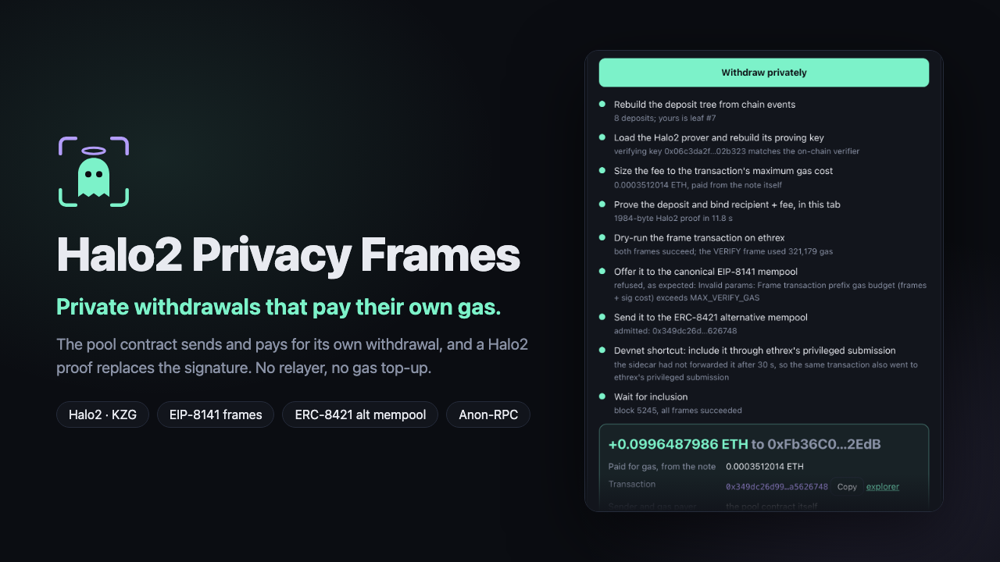
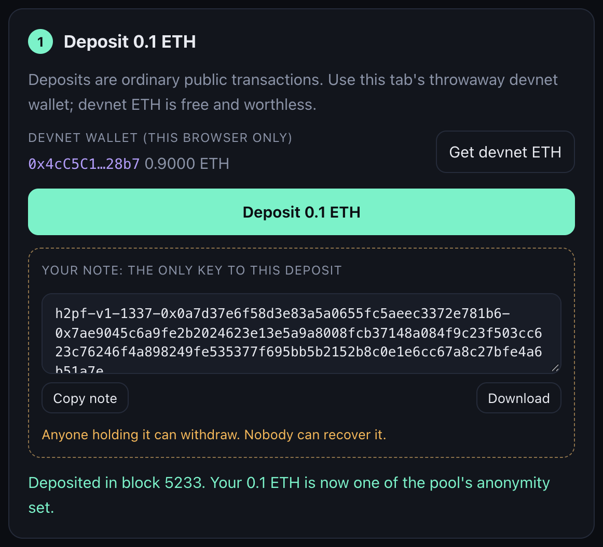
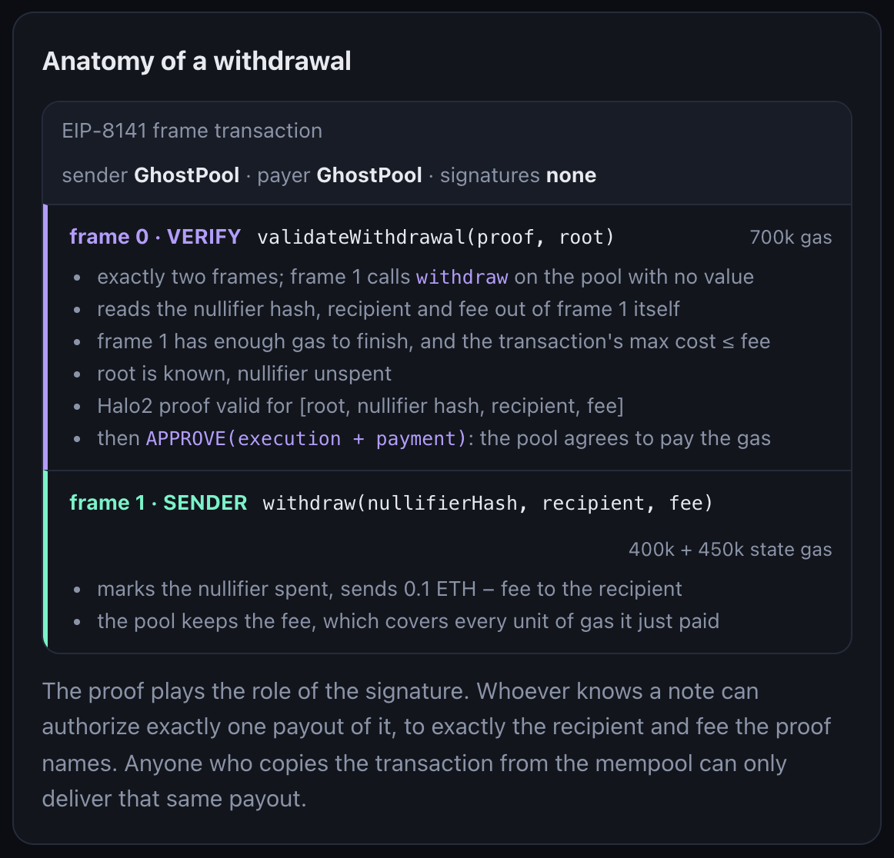
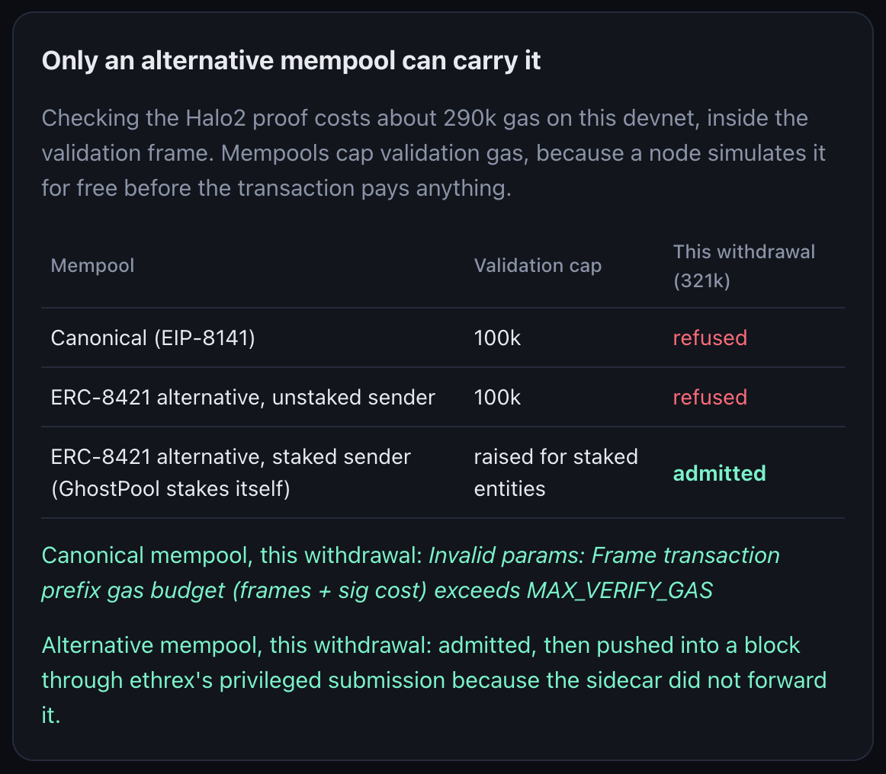

# Halo2 Privacy Frames



**Private withdrawals that pay their own gas.**

Deposit 0.1 ETH into a shielded pool. Later, withdraw it to a brand-new address that has never held a
wei: no relayer, no gas top-up, no link between the two addresses. The pool contract is the sender
**and the gas payer** of its own withdrawal, an [EIP-8141](https://eips.ethereum.org/EIPS/eip-8141)
frame transaction whose validation frame checks a **Halo2** proof instead of a signature.

Built at ETHGlobal Mumbai 2026 on the Ethereum Foundation's frame-transaction devnet, the
[ERC-8421 alternative mempool](https://docs.altmempool.wtf/) and [Anon-RPC](https://ethereum.github.io/anon-rpc/).

> **Status (Nov 6, 18:20 IST).** The ERC-8421 alternative mempool **admits** the pool's withdrawals: for
> `0x0f734b52ead7158105753b2dfd6fbcd4ee693861e7b479682599278857b160ea` its admission report reads
> `outcome: accepted`, with every rule passing (prefix, structure, gas limit, simulation, execution,
> OP-011 opcodes, COD-010 code access, storage). Search the hash on the
> [devnet explorer](https://explorer.altmempool.wtf/). That took EF enabling precompiles in the sidecar's
> validation after we reported it (its `precompiles` list had been empty). At the time of writing the
> sidecar had stopped forwarding admitted transactions to the block builder for every sender, so this
> one was waiting in its mempool.
>
> Withdrawals also execute on chain. In the runs below, a brand-new address that never held ETH received
> a 0.1 ETH note's payout from the pool, the transaction's sender and gas payer, with the Halo2 proof
> checked in the VERIFY frame. Both went into a block through ethrex's privileged submission, from before
> the precompiles were enabled:
>
> | Run | Transaction (devnet, chain 1337) | Recipient, never funded |
> |---|---|---|
> | `scripts/e2e.ts` | `0x88293e09cea4e0e50b7586d6772483c6e83ae11b04769aadbb047dbbfe2652a3` (block 946) | `0xF76E86696e39842ca6602bd899dC1FadcD25b559` got 0.0996487986 ETH |
> | the web app, proof made in the browser (14.3 s) | `0x199c9f97bdb588fc82c08b5fc435e7eec10953b04741fdbeb75dbf9c9123e467` (block 1053) | `0x140Af2DCD707DA8a5D389f1D1E78ffcC1D25793A` got 0.09964880124 ETH |
>
> Contracts: GhostPool `0x0a7d37e6f58d3e83a5a0655fc5aeec3372e781b6`, Halo2 verifier
> `0x98fe0dbf7a536e5f7559aa24a5af1ed1d956c24d`, PoseidonT3 `0x96918e7cdf8102a53b8b0caa8ee429d4d60179fa`
> (deployed after the devnet's Nov 6 reset).

## The problem: privacy breaks at the last step, gas

Every privacy pool (Tornado Cash, Privacy Pools, Railgun) has the same hole. To withdraw to a fresh
address you need gas on that address, so you either

- **fund it first**, which links it to you on chain, or
- **use a relayer**, a centralized party that can censor you, charges a fee, and sees your IP and timing.

And the reads a wallet makes while scanning for its deposits tell the RPC provider who you are.

## How it works

EIP-8141 lets any contract be a transaction's sender, as long as a `VERIFY` frame runs its validation
logic and calls `APPROVE`. So the pool authorizes its own withdrawal with a proof:

```
tx.sender = GhostPool            payer = GhostPool            signatures = none

frame 0  VERIFY  GhostPool.validateWithdrawal(proof, root)
           - exactly two frames; frame 1 is SENDER → pool.withdraw(...), value 0
           - reads nullifierHash, recipient, fee from frame 1's calldata
           - frame 1's gas limits are high enough that it cannot run out of gas
           - TXPARAM(MAX_COST) ≤ fee: the pool can never pay more gas than it is reimbursed
           - root is known, nullifier unspent
           - Halo2 proof valid for [root, nullifierHash, recipient, fee]
           - APPROVE(execution + payment)
frame 1  SENDER  GhostPool.withdraw(nullifierHash, recipient, fee)
           - marks the nullifier spent, pays 0.1 ETH − fee to the recipient, keeps the fee
```

The browser builds this transaction, proves it in a Web Worker, and hands it to the mempool itself,
with every request routed through Anon-RPC (Nox mixnet by default) under a per-withdrawal isolation key.

### Why it needs the alternative mempool

Checking the Halo2 proof costs **292k gas** on the devnet, inside the validation frame. A node simulates
validation for free before a transaction pays anything, so mempools cap it:

| Mempool | Validation gas cap | A withdrawal |
|---|---|---|
| Canonical (EIP-8141) | 100k | refused: "prefix gas budget (frames + sig cost) exceeds MAX_VERIFY_GAS" |
| ERC-8421 alternative, unstaked sender | 100k on this sidecar | refused: "validation prefix execution gas sum 700000 … exceeds MAX_VERIFY_GAS 100000" |
| ERC-8421 alternative, **staked** sender | raised for staked entities | passes the gas checks; on this devnet still refused by its empty precompile allowlist: "payer accesses un-deployed contract address 0x…05 with opcode STATICCALL" |

All three answers are real responses from the devnet to a withdrawal whose VERIFY frame had
just succeeded in ethrex's dry run, using 321k gas. ERC-7562, which ERC-8421 builds on, allows the core
precompiles during validation; the sidecar reads its list from a `PRECOMPILES` setting that the devnet
leaves empty.

This is the use case the alternative mempool exists for: validation that is expensive but bounded,
priced through stake and reputation instead of being banned outright. The app offers each withdrawal
to the canonical mempool first and shows its refusal, then sends it to the alternative mempool.

## The app

One static page with no backend: the devnet wallet, the Halo2 prover and the mempool client all run
in the browser tab. These screenshots are from a full run on the devnet on Nov 6: a deposit in block
5233 and its withdrawal in block 5245
(`0x349dc26d99cbfd3176616f3b4a95b0db3975875be5e42df8044f7977a5626748`).

**1. Deposit.** The page keeps a throwaway devnet wallet in this browser only. *Get devnet ETH* asks
the devnet's faucet for 1 ETH, and *Deposit 0.1 ETH* sends an ordinary transaction that adds a
Poseidon commitment to the pool's Merkle tree. The note is created in the tab before anything is
sent: it holds the deposit's two secrets, it is the only way to withdraw, and it never leaves the
browser.



**2. Withdraw to an address that has never held ETH.** Paste the note, click *New address* for a
recipient with zero balance and zero history, then *Withdraw privately*. The timeline is the protocol
as it runs:
- the tab rebuilds the deposit tree from the pool's events: 8 deposits, so this one hides among 8;
- it rebuilds the proving key and checks it against the on-chain verifier;
- it sizes the fee to the transaction's maximum gas cost, and proves in 11.8 s;
- ethrex's dry run passes both frames;
- the canonical mempool refuses it, because validation needs more than its 100k cap;
- the ERC-8421 alternative mempool admits it.

The fresh address received 0.0996 ETH, and the pool kept 0.00035 ETH to cover the gas it paid. On
this run the devnet's mempool node admitted the withdrawal but did not pass it on, so after 30 s the
app handed the same transaction to ethrex's privileged submission, and the result says so.


**3. What the browser sent.** The app's own breakdown of the frame transaction: the pool is the
sender and the gas payer, there is no signature, and frame 0's checks, ending in `APPROVE`, are what
allow frame 1's payout.



**4. Why only the alternative mempool carries it**, with this withdrawal's real verdicts: the
canonical mempool's refusal message, and the alternative mempool's admission.



## Measured numbers

| | |
|---|---|
| Circuit | halo2-base, 2^15 rows, 3 advice columns, ~82k cells (22 Poseidon permutations + Merkle path of depth 20) |
| Proof | 1,984 bytes, SHPLONK opening, Keccak transcript (EVM-verifiable) |
| Proving, native (M-series, all cores) | 0.6 s |
| Proving, browser (WASM, one thread) | 12 s |
| Proving key, rebuilt in the browser from public parameters | 4.9 s |
| Verifier | 12.9 KB, generated by snark-verifier; 292,418 gas on the devnet's ethrex (337k in revm) |

## Verified on the devnet

Each of these runs against the devnet's ethrex without mining anything, so they worked while the chain
was stalled:

| Script | What it showed |
|---|---|
| [`probe-verifier.mjs`](scripts/probe-verifier.mjs) | The verifier accepts a real proof (292,418 gas) and refuses the same proof with another fee |
| [`probe-frames.ts`](scripts/probe-frames.ts) | Every frame opcode `validateWithdrawal` reads returns what it expects: `TXPARAM` (frame count, current frame, `MAX_COST`), `FRAMEPARAM` (mode, target, value, data length, both gas limits) and `FRAMEDATALOAD` at offsets 0, 4, 36 and 68. EF's hegota-support had only taken these from the EIP text for this devnet |
| [`probe-pool.ts`](scripts/probe-pool.ts) | GhostPool deploys with its opcode helpers and its stake (13.1M gas), and after every deposit its on-chain root equals the TypeScript tree's |
| [`sim-encoding.ts`](scripts/sim-encoding.ts) | The signature-less withdrawal encodes and decodes, and the canonical mempool refuses it: "prefix gas budget exceeded: 700000 > 100000 (MAX_VERIFY_GAS)" |
| [`probe-gas.ts`](scripts/probe-gas.ts), [`probe-create.ts`](scripts/probe-create.ts) | What the devnet's resource-based gas model charges (below) |

**State gas, and the bug it caught.** On this devnet a new storage slot costs 110k gas and paying an
address with no account costs 196k, both charged as state gas that a frame's state limit must cover.
A withdrawal's payout frame writes the nullifier and usually creates the recipient's account: about
330k of state gas, but only 25k of execution gas. ethrex, though, only charges state gas while as
much execution gas is still available: with a 100k execution limit the payout ran out of gas, with
400k it succeeded. The pool's first floors (60k execution, 250k state) would therefore have let a
withdrawal pass validation and then fail in the payout, so the pool paid for a failed withdrawal that
could be replayed. Both floors are now 400k, and the app sends 400k execution and 450k state gas.
Code is charged by the byte too: PoseidonT3 costs 25.7M gas to deploy, the verifier 20.2M, the pool 13.2M.

**After the devnet reset** (Nov 6, ~12:00 IST) the contracts were deployed to the fresh chain, a deposit
and a withdrawal proof went through, ethrex's dry run of the withdrawal succeeded with both frames
(VERIFY 321k gas, payout 25k execution gas, the pool as payer), and the canonical mempool refused it.
The reset had removed the staking registry, so the pool waits to stake before the alternative mempool
admits it.

## Repository

| Path | What |
|---|---|
| [`circuits/ghost-circuit`](circuits/ghost-circuit) | The withdraw circuit: a circomlib-compatible Poseidon gadget, Merkle membership, nullifier, public inputs |
| [`circuits/ghost-cli`](circuits/ghost-cli) | Keygen, the Solidity verifier, native proving, revm gas measurement |
| [`circuits/ghost-wasm`](circuits/ghost-wasm) | The same prover for the browser (wasm-bindgen) |
| [`circuits/vendor/halo2-base`](circuits/vendor/halo2-base/VENDORED.md) | halo2-base 0.5.6 with `multicore` made optional so it builds for wasm32 |
| [`contracts/src`](contracts/src) | `GhostPool` (deposit, VERIFY-frame validation, payout) and `PoseidonMerkleTree` |
| [`app`](app) | The web app (Vite + React): deposit, withdraw, frame anatomy, request log |
| [`scripts`](scripts) | Build, deploy, end-to-end test, cross-implementation self-test, verifier probe |

The code keeps the project's working name, GhostFrame, in its identifiers: the `GhostPool` contract
and the `ghost-*` crates. Notes saved under that name (`ghostframe-v1-…`) still work.

Three implementations of the same hash and tree have to agree byte for byte: Rust in the circuit,
TypeScript (poseidon-lite) in the browser, Solidity (poseidon-solidity) on chain. They use circomlib's
Poseidon constants, checked against circomlib's published test vector, and
[`scripts/wasm-selftest.ts`](scripts/wasm-selftest.ts) checks the whole chain: a TypeScript tree, a
WASM proof, and the Solidity verifier accepting it.

## Security model

- **Anonymity set:** all deposits of the same denomination. A withdrawal reveals only the nullifier hash.
- **Front-running:** recipient and fee are public inputs of the proof. A copy of a pending withdrawal
  can only deliver the same payout to the same recipient.
- **Draining the pool:** frame 0 pins the exact transaction shape, so nobody can make the pool call
  anything else or move value; `MAX_COST ≤ fee` means a withdrawal can never cost the pool money;
  minimum gas limits mean `withdraw` cannot be made to run out of gas after approval; `withdraw` never
  reverts after approval (a recipient that refuses ETH is credited in `owed`).
- **Double spends:** a second transaction with the same nullifier fails validation at inclusion, so
  it is invalid and costs the pool nothing.
- **Network:** every request goes through Anon-RPC; the RPC endpoints and the mempool see the
  mixnet's exit, not you. If the chosen network is down, requests fail rather than go out directly.

### Trade-offs and limits

- **Devnet only, unaudited.** EIP-8141, ERC-8421 and the devnet are drafts and change.
- **Trusted setup:** Halo2-KZG needs only a universal setup. This project uses Axiom's k = 15 file from
  the Perpetual Powers of Tau ceremony (challenge 0085,
  `sha256 4cdb1688ec4457351582cc99a31e073279bb3abe1ee6fe04c401cc9e390ab67b`): no circuit-specific
  ceremony, unlike Groth16.
- **Fixed denomination** (0.1 ETH): no partial withdrawals or change notes yet.
- **No association sets.** A Privacy Pools-style proof of non-association with flagged deposits is the
  natural next step, and costs one more Merkle proof.
- **Timing correlation** between a deposit and a withdrawal is still up to the user.
- **Nonce contention:** withdrawals share the pool's account nonce. The proof does not commit to the
  nonce, so a withdrawal that loses a race is rebuilt and resent; EIP-8250 keyed nonces would remove the
  contention entirely.
- **Single-threaded browser proving** (12 s). Multi-threaded WASM would need cross-origin isolation.
- **Bootstrap read:** Anon-RPC fetches its pinned client bundle's hash with one ordinary request to a
  public Sepolia RPC before the mixnet exists.

## CROPS

The project's lead property is **privacy**, and it is structural: there is no relayer to trust or to
take down, so nothing operated by anyone else stands between a note and its withdrawal.

- **Censorship resistance:** no relayer and no backend. The browser submits withdrawals straight to the
  mempool, through a mixnet; anyone can run another copy of the static app.
- **Open source:** everything here is MIT-licensed, including the vendored halo2-base patch, and builds
  from source: circuit, verifier, contracts and app.
- **Privacy:** the proof breaks the on-chain link between deposit and withdrawal; self-paid gas removes
  the funding link; Anon-RPC removes the network link. Notes and keys stay in the browser; the page has
  no analytics or third-party trackers, and its request log shows every call it makes.
- **Security:** the pool cannot be drained through gas or through extra frames (see the security
  model); validation reads only the pool's own storage. Trade-offs are listed above, not hidden.

## Run it

Prerequisites: Node 20.12+, Rust (stable) with the `wasm32-unknown-unknown` target,
`cargo install wasm-bindgen-cli --version 0.2.130`.

```sh
npm install                                     # JS deps (a project .npmrc points at the public registry)
curl -o circuits/build/kzg_bn254_15.srs https://axiom-crypto.s3.amazonaws.com/challenge_0085/kzg_bn254_15.srs
cargo build --release --manifest-path circuits/Cargo.toml -p ghost-cli
circuits/target/release/ghost-cli setup circuits/build/kzg_bn254_15.srs circuits/build   # keygen + Solidity verifier
npm run compile                                 # contracts and verifier (solc-js 0.8.28)
npx tsx scripts/deploy.ts                       # devnet: PoseidonT3, verifier, GhostPool (staked)
npx tsx scripts/e2e.ts                          # deposit, prove, canonical refusal, alt-mempool withdrawal
npm run dev                                     # the app at http://localhost:5173
```

The browser prover is built with:

```sh
cargo build --release --manifest-path circuits/Cargo.toml -p ghost-wasm --target wasm32-unknown-unknown
wasm-bindgen --target web --out-dir app/src/wasm --out-name ghost circuits/target/wasm32-unknown-unknown/release/ghost_wasm.wasm
```

## Prize tracks

Ethereum Foundation, ETHGlobal Mumbai 2026: **Best Use of the Frame Transaction Alternative Mempool**
(primary), with Anon-RPC on by default for all of the app's traffic and a CROPS section above.

## AI usage

See [AI_USAGE.md](AI_USAGE.md).

## License

[MIT](LICENSE)
